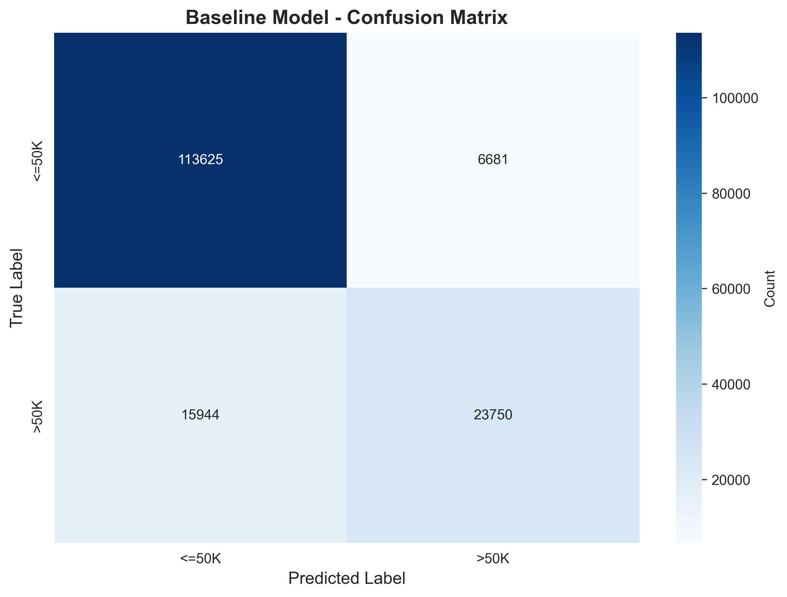
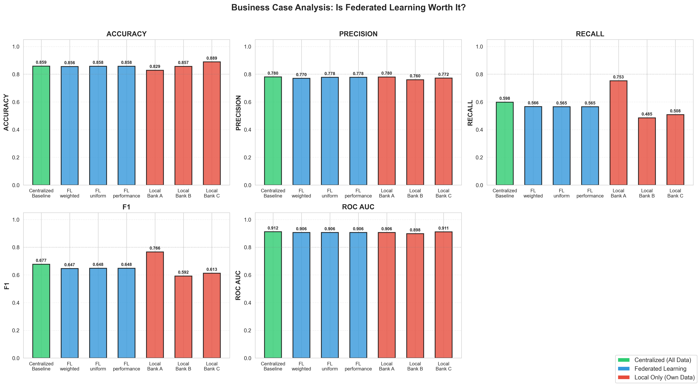
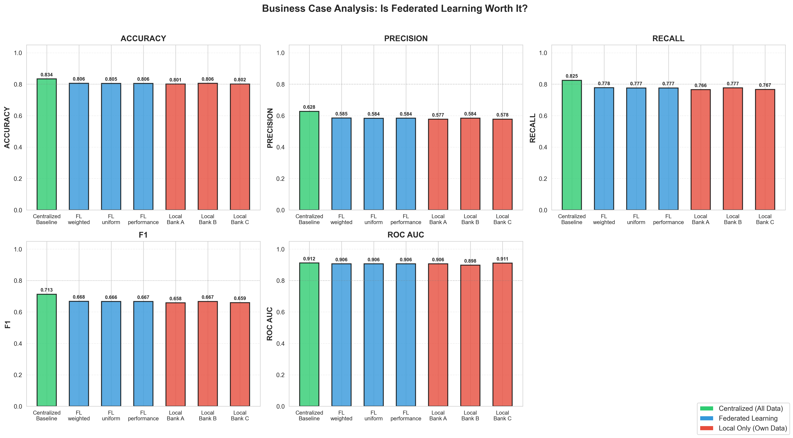
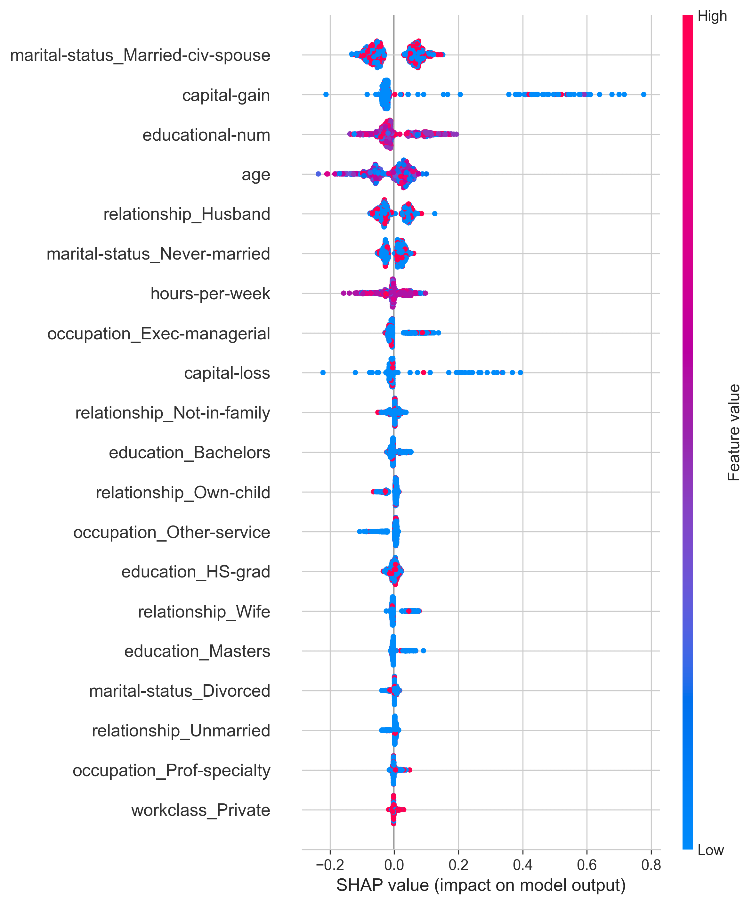
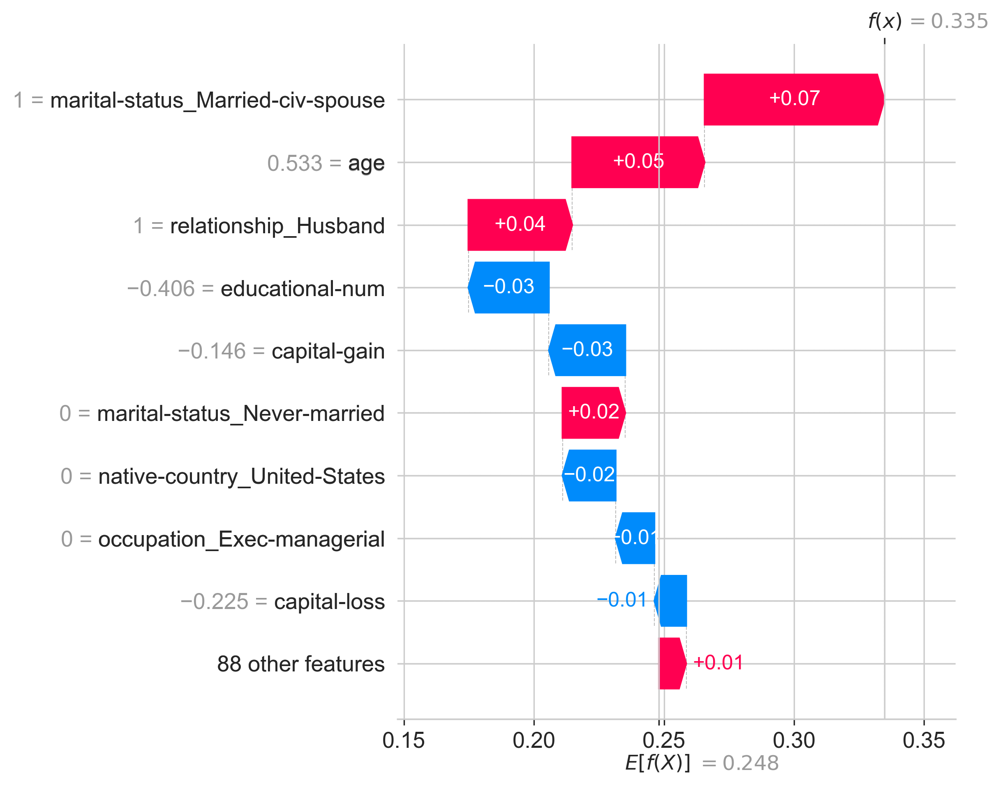

# Fair & Explainable Federated Learning for Banking

A machine learning system for income prediction across multiple banks, combining **fairness** (AIF360), **explainability** (SHAP), and **federated learning** (Flower) to enable privacy-preserving, bias-aware decision-making.

## Table of Contents

- [Motivation](#motivation)
- [Key Features](#key-features)
- [Approach](#approach)
- [Results](#results)
  - [Baseline Performance](#baseline-performance)
  - [Centralized vs. Federated vs. Local](#centralized-vs-federated-vs-local)
  - [Fairness Analysis](#fairness-analysis)
  - [Explainability](#explainability)
- [Project Structure](#project-structure)
- [Getting Started](#getting-started)
- [Configuration](#configuration)
- [Tech Stack](#tech-stack)

---

## Motivation

The banking sector operates under strict data protection regulations (e.g., GDPR), creating significant hurdles for centralized machine learning. If federated or even local ML architectures can achieve comparable performance, they are generally preferable due to their inherent privacy advantages.

This project investigates whether a centralized ML model justifies the additional legal and organizational overhead, or whether a federated architecture is the better choice. The analysis uses a synthetic dataset from three banks of varying size and with differently distributed customer data, particularly regarding income and education levels.

Since banking is a sensitive domain, the model is evaluated and improved across multiple **fairness metrics**, focusing on the protected attributes **gender** and **race**. Additionally, both global and local **SHAP explanations** are generated to support transparent decision-making and enable bank employees to understand model predictions for individual customers.

## Key Features

- **Federated Learning** with three aggregation strategies (weighted, uniform, performance-based) using the Flower framework
- **Fairness evaluation and mitigation** using IBM AIF360 (reweighing, threshold optimization, disparate impact remover)
- **SHAP explainability** with global (beeswarm) and local (waterfall) explanations
- **Business case comparison** across centralized, federated, and local-only training paradigms
- **Configurable pipelines** via YAML configuration files

## Approach

The system predicts income levels (>50K vs. ≤50K) using census-style data from three simulated banks (Bank A, B, C). A Random Forest classifier serves as the base model across all training paradigms:

| Paradigm | Description |
|---|---|
| **Centralized** | All bank data is pooled and a single global model is trained. Serves as the performance upper bound. |
| **Federated** | Each bank trains locally; models are aggregated without sharing raw data. Three aggregation methods are compared. |
| **Local** | Each bank trains independently on its own data only. Serves as the privacy-preserving lower bound. |

Fairness is enforced through pre-processing (reweighing) and post-processing (threshold optimization) on the protected attributes **gender** and **race**. Model decisions are explained using SHAP values at both the global and individual prediction level.

## Results

### Baseline Performance

The centralized baseline model achieves strong overall performance:

| Metric | Value |
|---|---|
| Accuracy | 0.860 |
| Precision | 0.786 |
| Recall | 0.602 |
| F1-Score | 0.682 |
| ROC-AUC | 0.914 |

<p align="center">
  
  <br>
  <em>Figure 1: Confusion matrix of the centralized baseline model on the test set (~160,000 samples).</em>
</p>

### Centralized vs. Federated vs. Local

For the business case, **precision** and **recall** are particularly important alongside accuracy:

- **Precision** indicates what percentage of customers classified as high-income actually are high-income. Low precision means the bank invests resources in premium advisory services for customers who do not qualify, causing unnecessary costs.
- **Recall** indicates what percentage of actual high-income customers are correctly identified. Low recall means many high-income customers are missed and therefore not offered appropriate services.

<p align="center">
  
  <br>
  <em>Figure 2: Business case comparison before threshold optimization. Federated models closely match the centralized baseline across all metrics, while local models show more variance due to smaller training sets.</em>
</p>

<p align="center">
  
  <br>
  <em>Figure 3: Business case comparison after threshold optimization. Adjusting decision thresholds per group improves recall across all paradigms while maintaining competitive precision and accuracy.</em>
</p>

**Key findings:**
- Federated learning achieves **comparable performance** to centralized training across all metrics (within 1-3% on most measures).
- **Bank A** achieves the best local performance because it has a more balanced class distribution, making it easier to predict high-income customers correctly.
- **Bank B and Bank C** benefit significantly from federated or centralized approaches due to their more imbalanced data.
- Threshold optimization significantly **improves recall** (from ~0.57 to ~0.78 for FL models) at a moderate cost to precision, improving the balance between the two metrics.
- The performance gap between federated and centralized models narrows further after threshold optimization, **reducing the justification for a centralized approach** given the regulatory overhead.
- ROC-AUC remains **stable across all paradigms** (~0.91), indicating consistent ranking quality.

### Fairness Analysis

Fairness is evaluated using three standard metrics on the protected attributes gender and race:

| Metric | Description | Fair Threshold |
|---|---|---|
| Disparate Impact Ratio (DIR) | Ratio of positive prediction rates between groups | ≥ 0.8 |
| Equalized Odds Difference (EOD) | Difference in true positive and false positive rates | ≈ 0 |
| Predictive Rate Parity | Equality of precision across groups | ≈ 0 |

Before mitigation, the baseline model exhibits significant bias (DIR for gender: 0.305, DIR for race: 0.557). The pipeline applies **reweighing** during training and **threshold optimization** at inference time to reduce these disparities.

### Explainability

SHAP (SHapley Additive exPlanations) provides both global and local model interpretability. These explanations can serve bank employees in customer advisory as well as provide transparency into how the model arrives at its predictions.

**Global explanation** ([Figure 4](#fig-shap-beeswarm)): The beeswarm plot shows the impact of each feature on model predictions across the entire test set. Features are ranked by importance, and the color indicates the feature value (high = red, low = blue).

<p align="center" id="fig-shap-beeswarm">
  
  <br>
  <em>Figure 4: SHAP beeswarm plot. The top features driving income predictions are marital status, capital gain, education level, and age. High values of capital-gain and educational-num strongly push predictions toward >50K.</em>
</p>

**Local explanation** ([Figure 5](#fig-shap-waterfall)): The waterfall plot explains an individual prediction by showing how each feature contributes to moving the output from the base value E[f(X)] to the final prediction f(x).

<p align="center" id="fig-shap-waterfall">
  
  <br>
  <em>Figure 5: SHAP waterfall plot for a single prediction (f(x) = 0.335). Being married (+0.07) and older age (+0.05) push the prediction above the base value (0.248), while lower education (-0.03) and capital gain (-0.03) pull it down.</em>
</p>

## Project Structure

```
├── data/
│   ├── raw/                          # BankA.csv, BankB.csv, BankC.csv
│   └── processed/                    # Scaler, encoder, feature names
├── docs/
│   └── images/                       # Figures used in this README
├── experiments/
│   ├── baseline_config.yaml          # Config for centralized baseline
│   └── federated_config.yaml         # Config for federated + comparison
├── notebooks/
│   └── baseline_overview.ipynb       # Exploratory baseline analysis
├── scripts/
│   ├── run_baseline_pipeline.py      # Train, evaluate, improve and explain centralized model
│   └── run_federated_pipeline.py     # Train federated and local models, compare to centralized
├── src/
│   ├── data/                         # Data loading & preprocessing
│   │   ├── data_loader.py
│   │   └── preprocessing.py
│   ├── models/                       # Model definitions
│   │   └── random_forest.py
│   ├── training/                     # Federated training logic
│   │   └── federated.py
│   ├── evaluation/                   # Metrics, fairness, explainability
│   │   ├── metrics.py
│   │   ├── fairness.py
│   │   └── explainability.py
│   └── utils/                        # Configuration & visualization helpers
│       ├── config.py
│       └── visualization.py
├── results/                          # Generated outputs (not tracked in git)
│   ├── models/                       # Trained model files (.joblib)
│   ├── plots/                        # Generated visualizations
│   └── reports/                      # Fairness & performance reports (JSON)
├── requirements.txt
├── setup.py
└── README.md
```

## Getting Started

### Prerequisites

- Python 3.9+
- pip

### Installation

```bash
git clone https://github.com/<your-username>/fair-federated-banking.git
cd fair-federated-banking
pip install -r requirements.txt
```

### Usage

**Step 1: Train the centralized baseline model**

```bash
python scripts/run_baseline_pipeline.py
```

Trains a fair, explainable Random Forest on the combined data from all three banks. Uses `experiments/baseline_config.yaml` for configuration. Outputs (trained model, fairness reports, SHAP plots) are saved to `results/`.

**Step 2: Run federated training and compare all paradigms**

```bash
python scripts/run_federated_pipeline.py
```

Trains local models per bank, creates federated ensembles with three aggregation strategies, and compares all paradigms against the centralized baseline. Applies threshold optimization for fairness. Uses `experiments/federated_config.yaml` for configuration.

## Configuration

Both pipelines are configured via YAML files in `experiments/`. Key parameters include:

| Parameter | Baseline | Federated |
|---|---|---|
| `n_estimators` | 300 | 200 |
| `max_depth` | 30 | 20 |
| `test_size` | 0.2 | 0.2 |
| Protected attributes | gender, race | gender, race |
| Fairness methods | reweighing, threshold optimization, disparate impact remover | threshold optimization |
| Aggregation strategies | — | weighted, uniform, performance |

See [`experiments/baseline_config.yaml`](experiments/baseline_config.yaml) and [`experiments/federated_config.yaml`](experiments/federated_config.yaml) for the full configuration.

## Tech Stack

| Category | Library |
|---|---|
| Core ML | scikit-learn, NumPy, pandas, SciPy |
| Federated Learning | [Flower (flwr)](https://flower.ai/) |
| Fairness | [IBM AIF360](https://aif360.readthedocs.io/), [Fairlearn](https://fairlearn.org/) |
| Explainability | [SHAP](https://shap.readthedocs.io/) |
| Visualization | Matplotlib, Seaborn |
| Configuration | PyYAML |
